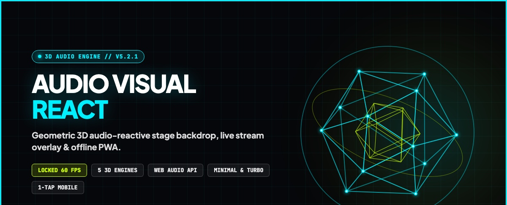
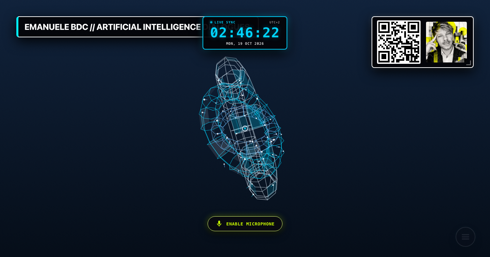
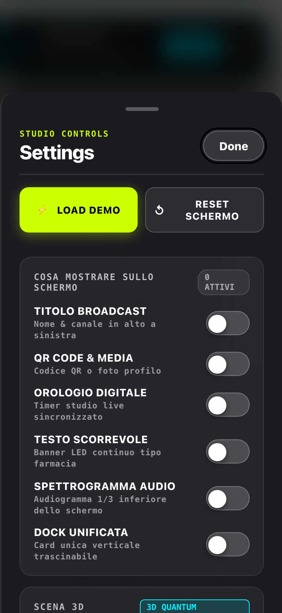
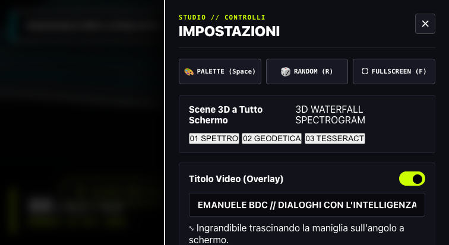

# AUDIO VISUAL REACT — 3D Geometric Audio-Reactive Studio Visualizer & Stage Backdrop

<p align="center">
  
</p>

> **"Pure geometric architecture in motion. Zero clutter. Instant audio reactivity."**  
> A high-performance, client-side Web Audio & 2D/3D Canvas engine engineered for live streamers, podcast broadcasts, keynote stages, and generative visual sets. Features 5 bespoke geometric engines, Minimal & Turbo motion profiles, 7 atmospheric palettes (including Swiss Paper White light mode), draggable title & QR stations, mobile 1-tap animation switching, and instant offline PWA capability.

[](https://emanuelebdc.com/ideas/audio-visual-react/)
[](https://emanuelebdc.com/ideas/)
[](https://github.com/emaf205/audio-visual-react)
[](VERSION.txt)
[](LICENSE)
[](https://emanuelebdc.com/ideas/audio-visual-react/)

---

## ✦ The Genesis & Why This Exists

Most audio visualizers and live streaming overlays on the web suffer from two fatal extremes:
1. **The Over-Engineered Blob**: Bloated GPU shaders that drown the screen in blurry neon soup, melting laptop CPUs and obscuring speaker facial feeds.
2. **The Generic Spectrum Bar**: Plain, sterile 2D frequency bars that look like an audio editor from 2004.

When broadcasting a podcast, delivering a keynote, or performing live, you need **architectural authority**. You need graphics that feel like high-end Swiss kinetic poster design: crisp geometric wireframes, mathematically precise rotations, high-contrast typography, and tactile control stations that you can freely reposition across the frame.

I built **AUDIO VISUAL REACT** in Milan to establish a new gold standard for browser-native broadcast visuals. It runs at a locked **60 FPS** on pure Canvas 2D without Three.js or heavy 3D engine bloat, listens dynamically to your microphone via the Web Audio API, and stores your entire layout, avatar, and QR codes locally with zero server dependencies.

---

## ✦ Live Interface & Visual Showcase

<p align="center">
  
  
</p>

<p align="center">
  
</p>

---

## ✦ The 5 Kinetic Geometric Channels (3D Engines)

Every channel is built on pure geometric mathematics, calculating 3D perspective projections, vertex noise perturbations, and depth sorting in real time:

- **CH 01 // 3D GEODESIC SPECTRUM**:
  - **Dual Nested Geodesic Shell**: 42-vertex, 80-face geodesic outer sphere coupled with an internal stellated icosahedron counter-rotating on an inverted phase.
  - **Triple-Axis Gimbal Gyroscope**: Equatorial Vernier tick-ring, meridian counter-ring, and polar zenith fork reacting to vocal resonance.
  - **Keplerian Particle Swarm**: 48 micro-nodes orbiting along eccentric 3D Keplerian ellipses with starlight flare intensity.

- **CH 02 // 3D HYPER TESSERACT**:
  - **4D Hypercube Projection**: 4D-to-3D isometric projection executing simultaneous rotation across $XW$, $YZ$, $ZW$, and $XY$ coordinate planes.
  - **Volumetric Translucent Facets**: Shaded polygonal planes providing tangible volumetric mass.
  - **Acoustic Shockwave Rings**: Concentric octagonal ripples detonated by bass transients and percussive vocal attacks.

- **CH 03 // 3D CYBER WARP TUNNEL**:
  - **Wandering Wormhole Flight**: Continuous 3D pitch, yaw, and roll navigation driven by Lissajous harmonic curves.
  - **32 Decagonal Structural Rings**: Ranging from 30 to 1600 units depth with reinforced bulkheads and aerospace cross-truss lattice (`/\/\/\`).
  - **Relativistic Warp Streaks**: 140 star particles stretching into hyper-speed lines as vocal intensity increases.

- **CH 04 // 3D QUANTUM SYNCHROTRON**:
  - **Tri-Toroidal Particle Accelerator**: Three interlocked relativistic rings rotating along mutually inclined magnetic planes.
  - **Relativistic Photon Packets**: 54 energy particles orbiting at frequencies modulated by real-time audio FFT bins.
  - **Central Singularity Beacon**: Pulsing core emitting radial corona discharge spikes.

- **CH 05 // 3D MATRIX MONOLITH**:
  - **Brutalist Obelisk**: Towering geometric monolith hovering in gravitational levitation.
  - **Audio Terrain Horizon**: 20×16 vector mesh undulating in response to bass and mid-frequency pressure.
  - **Ascending Runic Rings**: Concentric levitating rings climbing and expanding around the obelisk column.

---

## ✦ Studio Stations & Broadcast Controls

- **Station 1: Dynamic Speaker Card & Profile Avatar**:
  - Draggable anywhere on the canvas with spring settling.
  - Toggleable circular profile photo badge (upload custom file or paste image URL).
  - Modular S / M / L typography scales with tight Swiss tracking.
- **Station 2: Theme-Reactive Geometric Digital Clock Widget**:
  - Live architectural digital clock (`HH:MM:SS` with toggleable seconds and calendar date/UTC offset).
  - Dynamically adopts the active visualizer atmosphere colors (`--clock-accent`, `--clock-glow`, `--clock-primary`).
  - Draggable separately or dockable in unified mode.
- **Station 3: Scalable QR & Dual Media Hub**:
  - Independent toggles for **QR Code** and **Custom Image**: display QR only, Image only, **both simultaneously** (side-by-side / stacked responsive chassis), or neither.
  - Instant client-side QR Code generation with custom target link (`emanuelebdc.com` default).
  - Optional action CTA badge (*SCAN TO CONNECT*) and secondary URL text label.
  - Quick S / M / L size cycling by clicking the corner resize badge.
- **Station 4: Unified Vertical Dock (Stack Mode)**:
  - Dock all chosen stations (Title, Clock, Media) into a single vertical movable card.
  - Drag the entire column together as one unit or toggle off to float them separately.
- **Station 5: Bottom Spectrogram Dock**:
  - 1/4 screen height frequency analyzer featuring 72 precision audio bars with gradient fills and peak pip retention.
  - Real-time frequency axis labels (32Hz to 16kHz).
- **Station 4: Motion Profiles (Minimal vs. Turbo)**:
  - **Minimal**: Calibrated for keynote speeches, live interviews, and distraction-free webcam backdrops. Crisp vector lines and serene motion.
  - **Turbo**: High-energy broadcast mode with particle sparks, warp speed, and explosive transient spikes.
- **Station 5: 7 Curated Atmospheric Palettes**:
  - **Cobalt Horizon**: Electric Cyan `#00F0FF` + Cobalt Blue `#0072FF` on Deep Obsidian Slate.
  - **Campari Nocturne**: Intense Campari Red `#FF1A35` + Radiant Amber `#FF7A00` on Roasted Crimson.
  - **Emerald Cyber**: Acid Lime `#00FF88` + Matrix Mint `#00E5FF` on Cyber Pine.
  - **Ultra Violet**: Toxic Violet `#CC00FF` + Electric Magenta `#FF0066` on Deep Void.
  - **Amber Gold**: Pure Gold `#FFD700` + Warm Bronze `#FF8800` on Carbon Graphite.
  - **Mono Ice**: Optical White `#FFFFFF` + Subdued Platinum `#888888` on Deep Black.
  - **Swiss Paper White (Light Mode)**: Pure Architectural Black `#000000` line art on Warm Swiss Paper `#F8F8F6` with subtle dark gridlines.

---

## ✦ Mobile 1-Tap Ergonomics & Touch Gestures

Designed from the ground up for mobile broadcasting and instant smartphone operation:

1. **Floating Mobile Scene Pill**:
   - Ergonomic capsule pinned at bottom-left with touch target > 44px.
   - Shows active channel badge (`01-05`), uppercase scene title, and prev/next touch arrows (`‹` / `›`).
2. **Direct Background Tap**:
   - Tap anywhere on the open 3D canvas background (< 15px movement, < 350ms duration) to advance to the next geometric scene instantly.
3. **Swipe Gestures**:
   - Swipe Left: Next scene (`engine.nextScene()`).
   - Swipe Right: Previous scene (`engine.prevScene()`).
4. **Haptic Feedback**:
   - Integrated `navigator.vibrate(12)` provides a crisp tactile click on supported mobile devices.

---

## ✦ Complete Keyboard Shortcuts Matrix

| Key | Action | Details |
|:---:|---|---|
| <kbd>1</kbd> – <kbd>5</kbd> | **Direct Scene Select** | Lock directly into channels 01 through 05 |
| <kbd>→</kbd> / <kbd>↓</kbd> | **Next Scene** | Advance to next 3D geometric engine |
| <kbd>←</kbd> / <kbd>↑</kbd> | **Previous Scene** | Cycle backward through scenes |
| <kbd>Space</kbd> | **Next Atmosphere Palette** | Cycle through the 7 curated color themes |
| <kbd>R</kbd> | **Randomize & Auto-Rotate** | Pick a random scene & theme, resume auto-rotation |
| <kbd>S</kbd> | **Toggle Spectrogram** | Show / hide the 1/4 screen bottom frequency dock |
| <kbd>M</kbd> | **Mute / Unmute Microphone** | Toggle microphone input stream |
| <kbd>F</kbd> | **Toggle Fullscreen** | Expand to edge-to-edge broadcast display |
| <kbd>H</kbd> | **Zero-HUD Mode** | Hide all cards, pills, and buttons for clean capture |
| <kbd>Esc</kbd> | **Close Drawer / Exit Fullscreen** | Restore focus and dismiss active overlay |

---

## ✦ Technical Highlights & Architecture

```text
audio-visual-react/
├── index.html           # Semantic HTML5 stage layout & ARIA dialog drawer
├── style.css            # Swiss Total Bold design system, 100dvh, :focus-visible
├── visuals.js           # 5 Pure 3D geometric Canvas engines (zero external 3D libs)
├── app.js               # Web Audio API graph, safeStorageSet, touch & keyboard loop
├── qrcode.min.js        # Bundled zero-dependency offline QR code generator
├── manifest.webmanifest # PWA configuration (standalone, display-override)
├── service-worker.js    # Resilient cache-busting offline asset caching
├── VERSION.txt          # Semantic version tracker (v5.2.1)
├── CHANGELOG.md         # Comprehensive release notes
├── project.txt          # Ideas Hub metadata and classification
└── screenshots/         # High-resolution desktop and mobile previews
```

- **Pure Vanilla Web Standards**: Zero React, zero Vue, zero Three.js bloat. Pure ES6+ modern modules.
- **Web Audio API Real-Time Graph**: Fast Fourier Transform (`fftSize: 512`, `smoothingTimeConstant: 0.8`) with RMS volume calculation and split frequency energy bins (Bass, Mid, High).
- **Storage Resilience**: All client configuration writes use `safeStorageSet` to prevent unhandled `QuotaExceededError` or data corruption crashes.
- **WCAG AA Compliance**: Full keyboard focus trap on settings drawer, `:focus-visible` high-contrast focus rings, and semantic ARIA labeling on all icon controls.

---

## ✦ Quickstart & Offline Execution

```bash
# Clone the repository
git clone https://github.com/emaf205/audio-visual-react.git
cd audio-visual-react

# Start any local HTTP server
python3 -m http.server 8080
```

Open [http://localhost:8080](http://localhost:8080) in Chrome, Safari, or Edge. Click **Enable Microphone** or click anywhere on the canvas to activate the audio context.

---

## ✦ Author & Credits

Designed and engineered by **[Emanuele BDC](https://emaf205.com)** in Milan.  
Published on the **[EmaF205 Ideas Hub](https://emanuelebdc.com/ideas/)**.

Distributed under the **MIT License**. Free for personal broadcasts, commercial live streams, and creative performances.
